# ZTNA-ml

Панель Zero-Trust доступа поверх WireGuard, которая не только выдаёт доступ, но и
непрерывно оценивает доверие к каждому узлу по его трафику. Правила и ML-модель находят
аномалии: перебор паролей, сканеры, нетипичный объём выгрузки, необычные клиенты. Trust
engine снижает оценку доверия, и когда она падает ниже порога, шлюз автоматически
изолирует узел.

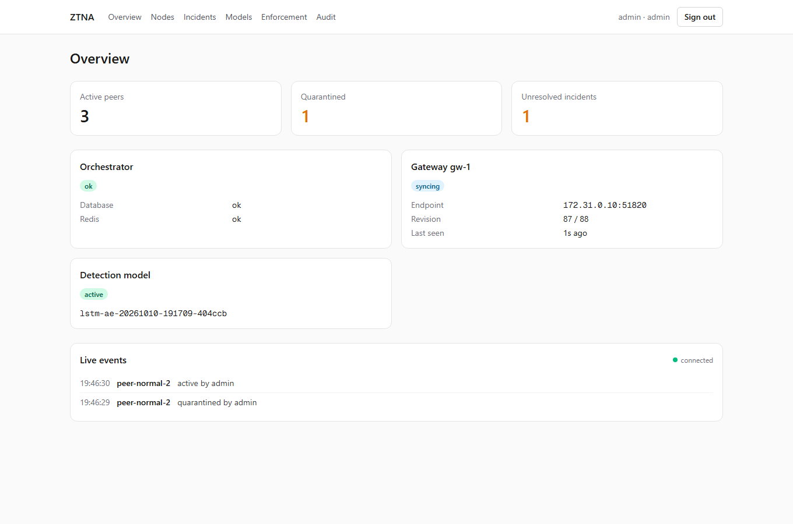

## Содержание

- [Как это работает](#как-это-работает)
- [Скриншоты](#скриншоты)
- [Детектирование](#детектирование)
- [Качество моделей](#качество-моделей)
- [Безопасность](#безопасность)
- [Запуск](#запуск)
- [Проверка](#проверка)
- [Структура репозитория](#структура-репозитория)
- [Ограничения и что дальше](#ограничения-и-что-дальше)

## Как это работает

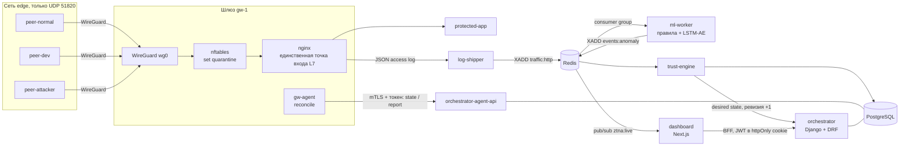

1. **Доступ.** Пир подключается по WireGuard и видит только один адрес — nginx на шлюзе
   (`10.13.0.1:80`). Маршрутов во внутреннюю сеть у него нет: nftables режет любой forward
   с `wg0`. Каждый запрос проходит через L7-прокси и попадает в JSON-лог.
2. **Телеметрия.** `log-shipper` читает лог (с учётом ротации, at-least-once, оффсет
   сохраняется после записи в Redis) и пишет в Redis Stream `traffic:http`.
3. **Детектирование.** `ml-worker` раскладывает запросы по 30-секундным окнам каждого
   пира. Правила срабатывают сразу, на каждом запросе. Модель оценивает окно, когда оно
   закрывается, вместе с историей пира за последние 5 минут.
4. **Доверие.** `trust-engine` считает
   `trust = 100 − Σ penaltyᵢ · e^(−Δtᵢ/τ)`, открывает инциденты и принимает решение:
   карантин, отзыв или снятие карантина.
5. **Применение.** Решение меняет desired state и поднимает ревизию шлюза. `gw-agent`
   каждые 2 секунды забирает состояние по mTLS, сравнивает его с `wg show dump` и
   nft-сетом и применяет разницу. От атаки до сетевой изоляции проходит 5–10 секунд.
6. **Наблюдение.** Дашборд получает события в реальном времени по SSE, через подписку
   BFF на Redis pub/sub.

## Скриншоты

| | |
|---|---|
| 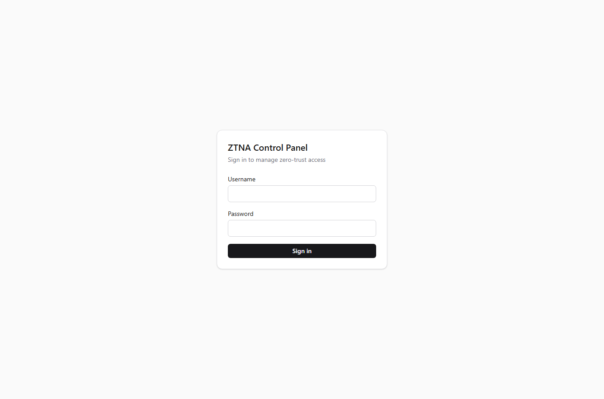 | **Вход.** JWT от оркестратора хранится только в httpOnly-cookie. Попытки входа ограничены по частоте (10 в минуту). |
|  | **Overview.** Сколько пиров активно и сколько в карантине, открытые инциденты, состояние оркестратора и шлюза (ревизия «применено / желаемо»), развёрнутая модель и лента событий в реальном времени. |
| 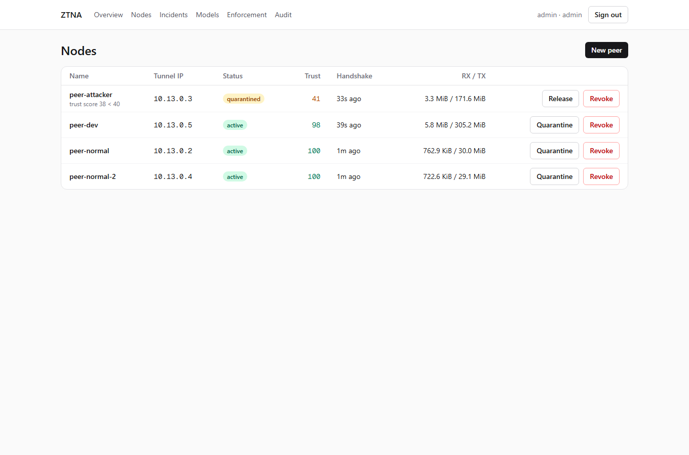 | **Nodes.** Все пиры с туннельным IP, статусом, trust score, последним handshake и трафиком. Кнопки зависят от роли: аналитик ставит в карантин и снимает его, отзывает только админ. Таблица обновляется сама по live-событиям. |
| 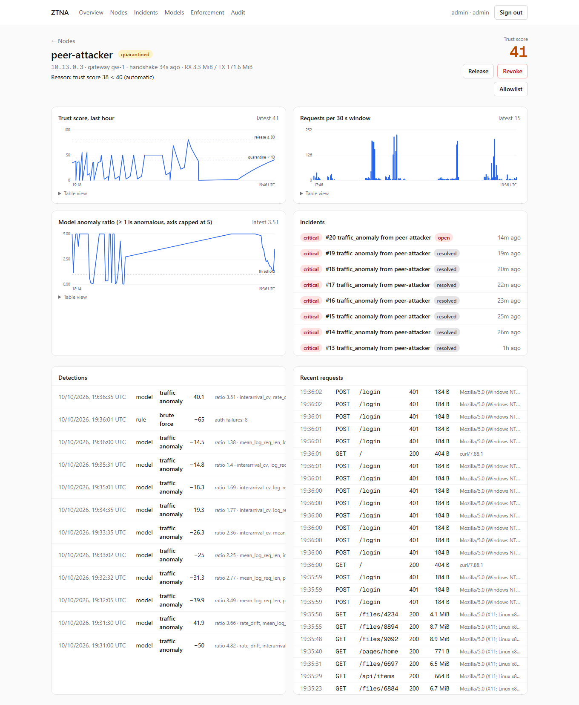 | **Карточка узла после атаки.** График trust score с порогами карантина и снятия, запросы по окнам, anomaly ratio модели, инциденты, детекции с причинами (`top_features` модели, счётчики правил) и последние запросы. Здесь видно, как брутфорс уронил скор, а шлюз изолировал узел. |
| 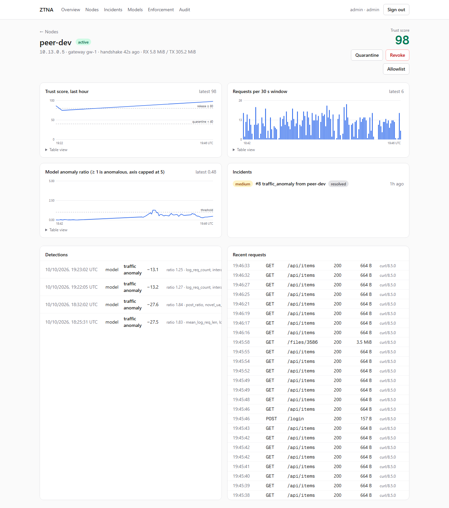 | **Нормальный узел с тяжёлым профилем.** Разработчик регулярно выгружает десятки мегабайт. Правило объёма сравнивает выгрузку с личной нормой узла, поэтому на такое поведение не срабатывает. |
| 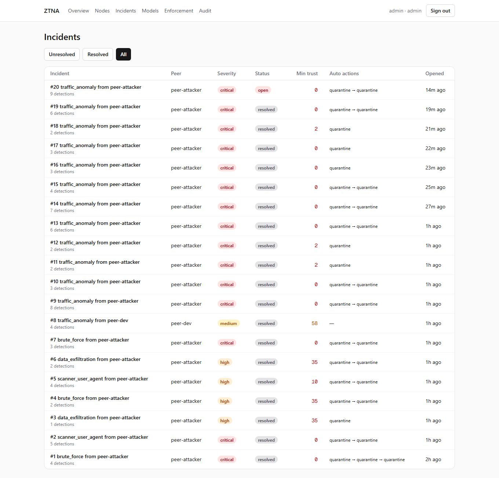 | **Incidents.** Инцидент открывается, только когда доверие упало ниже 70, поэтому единичные слабые сигналы не создают шум. Для каждого видны тяжесть, минимальный скор и автоматические действия. |
| 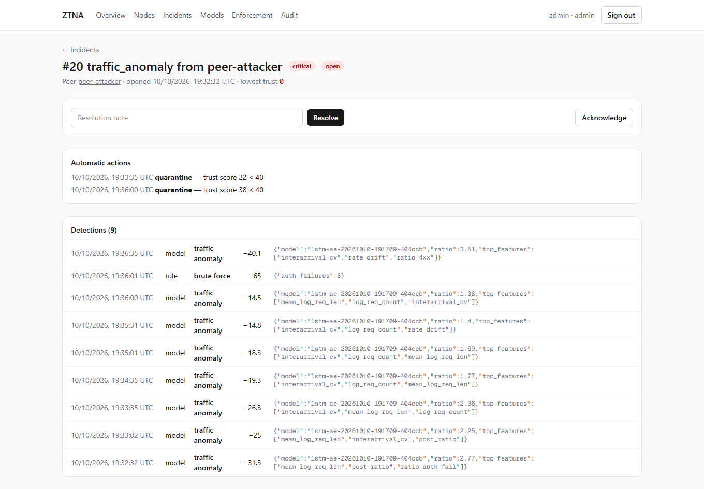 | **Инцидент.** Хронология детекций и автоматических действий. Аналитик может подтвердить (acknowledge) или закрыть инцидент с заметкой; всё попадает в аудит. |
| 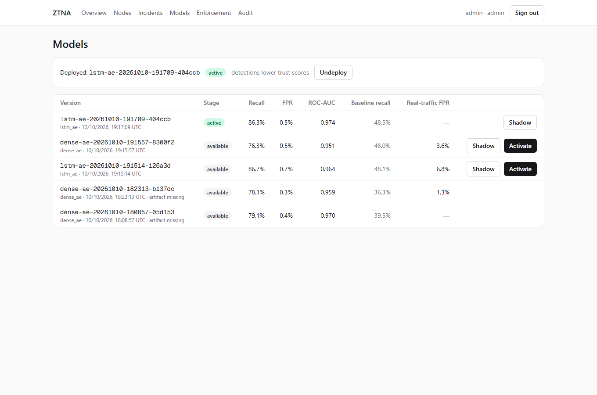 | **Models.** Реестр обученных моделей: recall, FPR, ROC-AUC, recall бейзлайна IsolationForest, FPR на реальном трафике. Модель включается в режим `shadow` (только логирует) или `active`. Воркер подхватывает её без рестарта. |
| 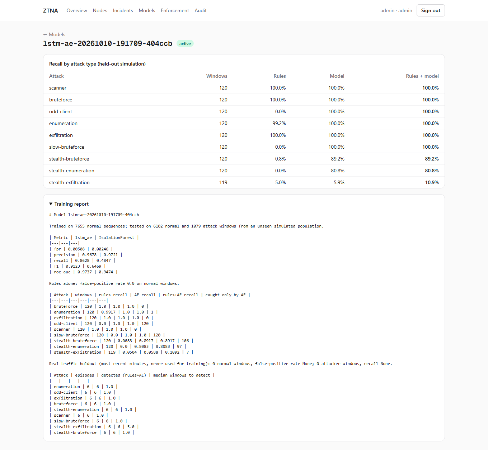 | **Отчёт обучения.** Recall по каждому типу атаки: отдельно правила, модель и их сумма, плюс сколько окон ловит только модель. |
| 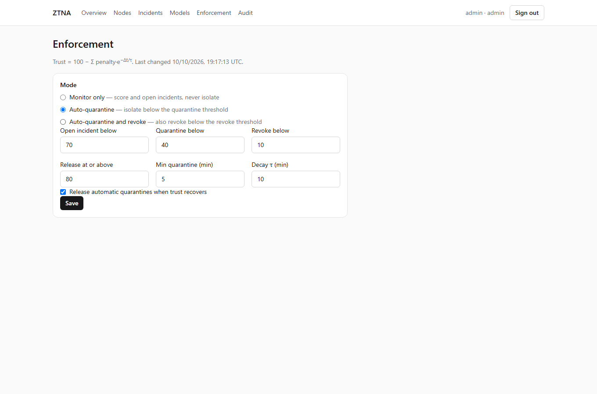 | **Enforcement.** Режим работы (monitor, auto-quarantine, auto-revoke), пороги инцидента, карантина, отзыва и снятия (с гистерезисом), минимальное время карантина, постоянная затухания τ. Менять может только админ. |
| 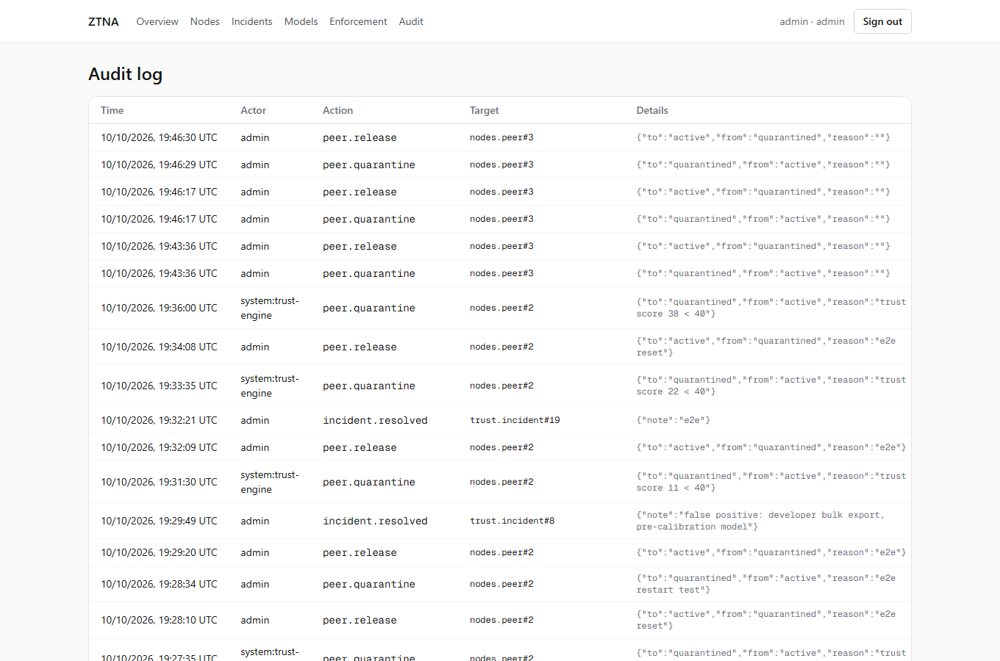 | **Audit.** Все изменения состояния: кто (человек или `system:trust-engine`), что и с какими параметрами. |
| 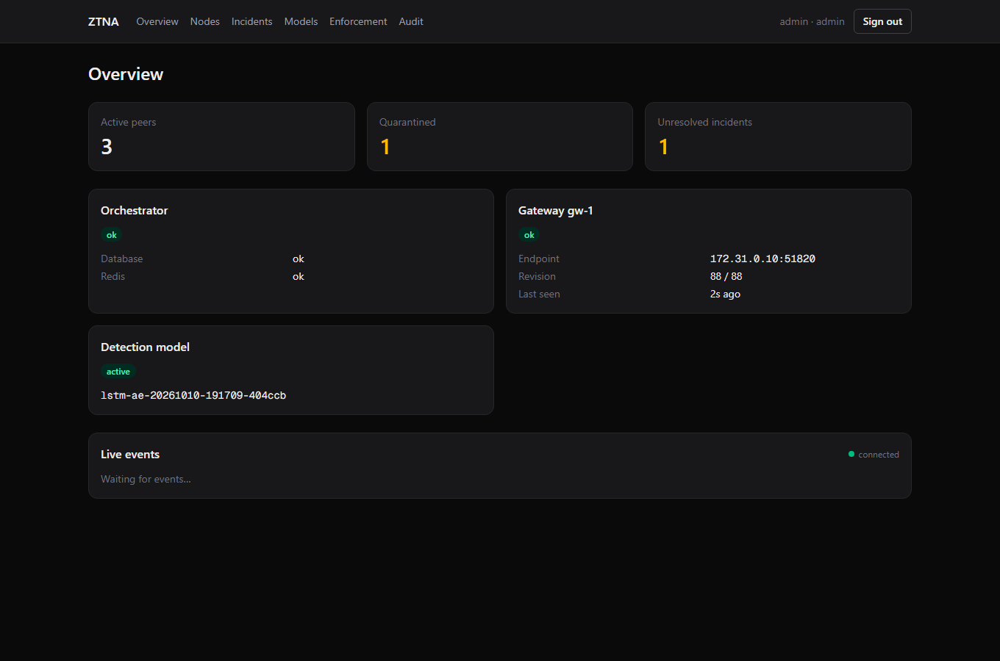 | **Тёмная тема** включается по системной настройке. Цвета графиков проверены на контраст для обеих тем. |
| 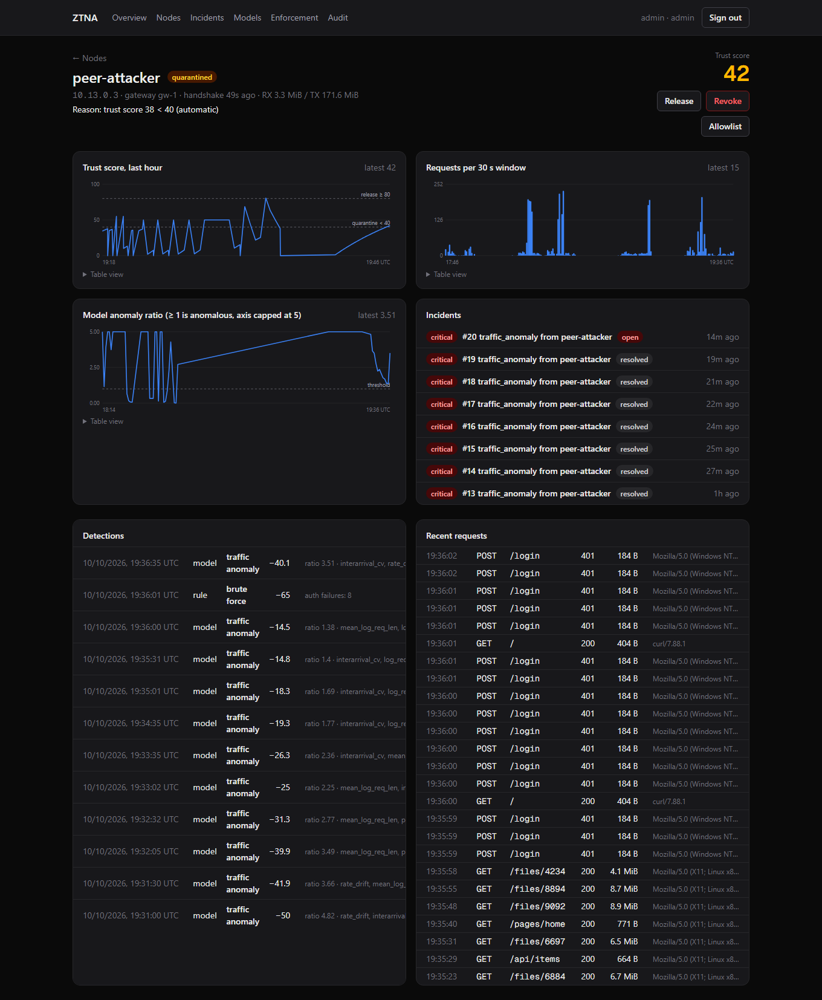 | Карточка узла в тёмной теме. Время везде в UTC, на сервере и в браузере одинаково. |

## Детектирование

Три слоя. Каждый закрывает то, что плохо ловят другие.

### 1. Правила на окне (мгновенно, на каждом запросе)

| Правило | Условие за окно 30 с | Штраф |
|---|---|---|
| `brute_force` | ≥ 8 ответов 401/403 на auth-пути | 65 |
| `scanner_user_agent` | UA сканера (sqlmap, nikto, gobuster, nuclei…) | 45 |
| `path_enumeration` | ≥ 15 ответов 404, ≥ 70% уникальных путей | 45 |
| `data_exfiltration` | ≥ 64 МБ отдано за окно | 65 |
| `request_flood` | ≥ 300 запросов | 30 |
| `missing_user_agent` | ≥ 5 запросов без UA | 10 |

Пороги задаются через переменные окружения `RULE_*` (см. `ml/ztna_ml/rules.py`).

### 2. Правило объёма относительно нормы узла

`sustained_exfiltration` срабатывает, если узел отдал за 10 минут больше, чем
`max(200 МБ, 8 × его обычный объём за 10 минут)`. Обычный объём узла — робастная
медленная EWMA: первые 5 минут считается простое среднее, потом окна выше 4× нормы
обрезаются и учитываются с весом в 10 раз меньше. Поэтому затяжная выгрузка не может
сама поднять себе лимит, а реальная смена привычек всё равно усваивается за часы. На
холодном старте действует абсолютный потолок 500 МБ за 10 минут.

### 3. Модель

Окно описывается 16 признаками (`ml/ztna_ml/features.py`): частота запросов, доли
4xx/404/401/5xx, уникальность путей, объём, длина запроса, доля POST, число UA, доля
новых для узла UA, равномерность интервалов и два drift-признака — отношение быстрой
EWMA к медленной для объёма и частоты запросов этого узла.

- **LSTM-AE** (в проде) восстанавливает последовательность последних 10 окон узла.
  Она ловит поведение, которое необычно во времени, а не в одном окне.
- **Dense-AE** восстанавливает одно окно. Остаётся как альтернатива.
- **IsolationForest** — бейзлайн для сравнения.

Модели обучаются только на нормальном трафике: синтетическом плюс реальном трафике этой
сети. Порог — квантиль 99.5% ошибки на синтетической валидации, но не ниже квантиля 99%
на реальной. Инференс через ONNX Runtime, без torch: ~0.2 мс на окно, ~10 000
запросов/с на ядро (`python -m ztna_ml.bench`). Модель штрафует мягко,
`10 + 12·(ratio − 1)` с потолком 50, а в детекции пишет три признака с наибольшей
ошибкой как объяснение.

### Trust score и решения

- Скор: `100 − Σ penalty·e^(−Δt/τ)`, τ = 10 мин.
- Инцидент открывается при trust < 70. Карантин — при < 40, а в режиме auto_revoke при
  < 10 узел отзывается.
- Карантин, поставленный системой, снимается сам, когда trust ≥ 80 и прошло не меньше
  5 минут (гистерезис и защита от дребезга). Ручной карантин система не снимает.
- Ручное снятие карантина аналитиком «прощает» узлу прошлые аномалии, иначе следующий
  тик снова изолировал бы его. Новые аномалии считаются как обычно.
- Allowlist: узел оценивается, но никогда не изолируется автоматически.

## Качество моделей

Тест — отдельная симулированная популяция (другой seed): 16 нормальных пользователей
(браузер и разработчик) и по 6 атакующих на каждый из 9 сценариев. Перед атакой каждый
атакующий 5–20 минут ведёт себя нормально.

| Метрика (окна) | LSTM-AE | Dense-AE | IsolationForest |
|---|---|---|---|
| Recall | **0.863** | 0.763 | 0.485 |
| FPR | 0.51% | 0.52% | 0.25% |
| ROC-AUC | **0.974** | 0.951 | 0.947 |

Recall по сценариям (правила + LSTM-AE, доля окон атаки):

| Атака | Только правила | LSTM-AE | Вместе | Эпизоды найдены |
|---|---|---|---|---|
| bruteforce, scanner, exfiltration | 100% | 100% | 100% | 6/6 |
| enumeration | 99% | 100% | 100% | 6/6 |
| odd-client (редкий клиент, высокий темп) | 0% | 100% | 100% | 6/6 |
| slow-bruteforce (под порогом правила) | 0% | 100% | 100% | 6/6 |
| stealth-bruteforce (вперемешку с браузингом) | 1% | 89% | 89% | 6/6 |
| stealth-enumeration | 0% | 81% | 81% | 6/6 |
| stealth-exfiltration (~0.7 МБ/с внутри сессии) | 5% | 6% | 11% | 6/6, медиана 5 окон |

Как это читать:
- Громкие атаки закрывают правила: мгновенно, объяснимо и без ложных срабатываний.
- Модель добавляет то, что правила не видят: скрытый перебор, медленный брутфорс,
  необычных клиентов. Здесь LSTM заметно сильнее Dense-AE (89% против 44% на
  stealth-брутфорсе).
- Скрытую выгрузку не ловит ни одна модель. На уровне окна она неотличима от обычного
  разработчика. Её ловит правило объёма относительно нормы узла: каждый эпизод найден,
  медианная задержка ~2.5 минуты.

**На реальном трафике стенда** (модель его не видела): у LSTM-AE recall на атаках 100%
(19 окон) при FPR 9.5% на нормальных окнах; у Dense-AE recall 59% при FPR 3.6%. В
нормальный трафик здесь входят и сами e2e-проверки: curl с каждого пира раз в секунду,
и большая часть ложных окон приходится на них. Ложные срабатывания слабые (ratio
1.0–1.7, штраф 10–18) и быстро затухают. За полные e2e-прогоны ни один нормальный узел
не попал в карантин и не получил инцидента.

## Безопасность

- **Zero trust на сетевом уровне.** Из туннеля доступен только L7-прокси, forward во
  внутренние сети запрещён. Карантин — это сет nftables, обратимый и мгновенный. Правило
  на сет стоит перед `ct established`, поэтому уже открытые соединения тоже рвутся.
- **Ключи WireGuard.** Приватный ключ шлюза не покидает шлюз, оркестратор знает только
  pubkey. Ключи пиров генерируются на сервере, клиентский конфиг отдаётся один раз и
  нигде не хранится. Можно зарегистрировать пира и со своим pubkey.
- **Канал до шлюза.** Агентский API живёт в отдельном процессе с отдельным URLconf,
  gunicorn требует клиентский сертификат (`cert-reqs=2`), а шлюз дополнительно
  предъявляет токен (в базе хранится SHA-256). Через публичный порт 8000 агентских ручек
  нет вообще.
- **Fail-static.** Если оркестратор недоступен, шлюз держит последнее применённое
  состояние. Агент сам исправляет ручной дрейф nft и wg.
- **Пользователи.** RBAC (viewer / analyst / admin) на каждом действии, аудит всех
  мутаций, JWT с коротким access (15 мин) и ротацией refresh, ограничение частоты входа.
- **Дашборд.** BFF: браузер ходит только на свой origin, токены в httpOnly-cookie. Есть
  CSP, `frame-ancestors 'none'`, nosniff, Referrer-Policy и Permissions-Policy.
- **ML-деплой.** Версия модели проверяется регуляркой (защита от path traversal). Модель
  с другим набором признаков не загрузится. Новая модель сначала идёт в shadow.
- **Эксплуатация.** У всех фоновых сервисов healthcheck по heartbeat, Postgres
  бэкапится каждые 6 часов (хранятся 7 дней).

## Запуск

Нужен Docker Desktop с WSL2-бэкендом: в ядре WSL2 уже есть WireGuard.

```sh
cp deploy/.env.example deploy/.env   # поменять все секреты
docker compose -f deploy/docker-compose.yml up -d --build
```

| Что | Где |
|---|---|
| Dashboard | http://localhost:3000 (логин и пароль — `DJANGO_ADMIN_*` из `.env`) |
| Orchestrator API | http://localhost:8000/api/, health — `/healthz` |
| Django admin | http://localhost:8000/admin/ |

При старте поднимаются шлюз, оркестратор и четыре симулированных устройства:
`peer-normal` и `peer-normal-2` (браузинг), `peer-dev` (CLI и выгрузки) и
`peer-attacker` (по умолчанию молчит).

### Атаки вручную

```sh
docker compose -f deploy/docker-compose.yml exec -d peer-attacker traffic bruteforce --duration 60
# сценарии: bruteforce, slow-bruteforce, stealth-bruteforce, scanner, enumeration,
# stealth-enumeration, exfiltration, stealth-exfiltration, odd-client
```

### Обучение и деплой модели

```sh
# синтетика + 90 минут реального трафика стенда; IP атакующего исключается из «нормы»
docker compose -f deploy/docker-compose.yml --profile train run --rm ml-train \
  ztna_ml.train --out /models --model lstm --real-minutes 90 --exclude-ip 10.13.0.3
```

Потом в дашборде: **Models → Shadow**. Когда в shadow всё спокойно — **Activate**.
Проверить FPR модели на реальном трафике:

```sh
docker compose -f deploy/docker-compose.yml --profile train run --rm --entrypoint python \
  ml-train -m ztna_ml.livecheck --model /models/<version> --attacker 10.13.0.3 --minutes 30
```

### Продакшен-настройки

`DJANGO_SECURE_COOKIES=1` и `DJANGO_BEHIND_TLS_PROXY=1` за TLS-терминатором,
`DJANGO_CSRF_TRUSTED_ORIGINS`. Dev-PKI (`deploy/pki/gen-dev-pki.sh`) заменить сертификатами
своего CA. Секреты передавать через docker secrets или vault, а не через `.env`.

## Проверка

| Набор | Команда | Что проверяет |
|---|---|---|
| Orchestrator | `cd orchestrator && pytest` | сервисы пиров, переходы статусов, IP-пул, RBAC, agent API, trust engine (затухание, гистерезис, allowlist, прощение), registry моделей — 45 тестов |
| ML | `cd ml && pytest` | окна, признаки, правила, правило объёма (включая защиту нормы от «отравления»), датаген, совпадение torch и ONNX для обеих моделей, hot-reload — 22 теста |
| gw-agent | `cd gateway/agent && pytest` | парсинг `wg`/`nft`, план изменений и его порядок, fail-static |
| log-shipper | `cd services/log-shipper && pytest` | неполные строки, чекпоинт, усечение файла |
| E2E | `python deploy/e2e.py --attacks bruteforce,scanner,exfiltration,odd-client,stealth-bruteforce,stealth-exfiltration` | туннель, изоляция по каждой атаке с SLA, nft-сет, нормальные узлы без инцидентов, release, восстановление после рестарта шлюза |
| UI | `cd dashboard && npx playwright test` | вход, ошибки, карантин из UI с live-событием на другой вкладке, все разделы |
| Скриншоты | `SCREENSHOTS=1 npx playwright test e2e/screenshots.spec.ts` | обновляет `docs/screenshots/` |

Для UI-тестов нужны `E2E_USER` и `E2E_PASSWORD`. CI (`.github/workflows/ci.yml`)
гоняет линтеры и unit-тесты всех компонентов и собирает все образы.

## Структура репозитория

```
gateway/              WireGuard + nftables + nginx; agent/ — gw-agent (stdlib Python)
orchestrator/         Django: accounts, nodes (пиры, шлюзы, agent API), trust (скор,
                      инциденты, enforcement), mlops (реестр моделей), audit
ml/                   ztna_ml: события, окна и признаки, правила, правило объёма, воркер,
                      модели (dense_ae, lstm_ae, iforest), датаген, обучение, оценка,
                      livecheck, бенчмарк
dashboard/            Next.js (App Router): BFF, SSE, страницы, Playwright
services/             protected-app (демо-сервис), log-shipper
simulator/peer/       устройство-пир и профили поведения (общие для live и датагена)
deploy/               docker-compose, dev-PKI, бэкапы, e2e.py
docs/screenshots/     скриншоты для этого README
```

## Ограничения и что дальше

- **Синтетика ≠ реальность.** Профили поведения упрощены. На реальном трафике FPR
  модели заметно выше, чем на синтетике, поэтому у модели мягкие штрафы, а решение
  принимается по накопленному скору. Модель стоит регулярно переобучать на свежем
  трафике: после смены профилей устройств FPR вырос из-за дрейфа, и именно
  переобучение его вернуло.
- **Один воркер.** Состояние окон и норм узлов живёт в памяти и теряется при рестарте:
  норма перестраивается за ~5 минут. Для горизонтального масштабирования нужно шардить
  `traffic:http` по пирам и хранить нормы в Redis.
- **Задержка модели.** Модель отвечает на закрытии окна, это 35+ секунд. Громкие атаки
  правила изолируют за 5–10 секунд.
- **Один шлюз в демо.** Модель данных и агент рассчитаны на несколько шлюзов, но
  проверен только один.
- **Postgres не партиционирован.** `TrustScoreSnapshot` и `AnomalyEvent` при росте стоит
  партиционировать по времени (или вынести в TimescaleDB).
- **Нет OIDC/SSO.** Пока только локальные пользователи Django.
