# ZTNA-ml

Панель доступу за принципом нульової довіри (Zero Trust Network Access) поверх WireGuard.
Вона не лише видає доступ, а й безперервно оцінює довіру до кожного вузла за його
трафіком. Правила та ML-модель виявляють аномалії: підбір паролів, сканери, нетипові
обсяги вивантаження, незвичні клієнти. Що нижча довіра, то менше ресурсів доступно вузлу:
спершу закриваються чутливі сервіси, а за дуже низької довіри шлюз повністю ізолює вузол.


## Зміст

- [Можливості](#можливості)
- [Як це працює](#як-це-працює)
- [Скриншоти](#скриншоти)
- [Адаптивний доступ до ресурсів](#адаптивний-доступ-до-ресурсів)
- [Виявлення](#виявлення)
- [Масштабування ML-воркерів](#масштабування-ml-воркерів)
- [Безперервне навчання](#безперервне-навчання)
- [Кілька шлюзів](#кілька-шлюзів)
- [Єдиний вхід (SSO)](#єдиний-вхід-sso)
- [Сповіщення](#сповіщення)
- [Зберігання даних](#зберігання-даних)
- [Якість і швидкість](#якість-і-швидкість)
- [Безпека](#безпека)
- [Запуск](#запуск)
- [Перевірка](#перевірка)
- [Структура репозиторію](#структура-репозиторію)
- [Обмеження](#обмеження)

## Можливості

- **Доступ через WireGuard** із вузлами на кількох шлюзах (майданчиках). Ключі генеруються
  на сервері, клієнтська конфігурація видається один раз.
- **Оцінка довіри в реальному часі**: правила на кожному запиті, правило обсягу відносно
  норми вузла, LSTM-автоенкодер на послідовності вікон. Довіра згасає експоненційно.
- **Адаптивний доступ**: кожен ресурс має власний поріг довіри та групи вузлів. Знижена
  довіра закриває чутливі ресурси без повного карантину.
- **Автоматичне реагування**: карантин через nftables, відкликання, автоматичне зняття
  з гістерезисом, білий список, режим лише моніторингу.
- **Горизонтальне масштабування ML**: трафік поділено на шарди, воркери ділять їх між
  собою через оренди в Redis, стан зберігається чекпоінтами й переживає падіння воркера.
- **Безперервне навчання**: champion/challenger, контроль дрейфу, тренер за розкладом,
  при дрейфі або на вимогу, перевірки якості, автоматична промоція.
- **Єдиний вхід** через OpenID Connect (Keycloak у комплекті), ролі з постачальника.
- **Сповіщення** в Telegram, Slack або вебхук (SIEM/SOAR) з повторами та підписом HMAC.
- **Українська мова** інтерфейсу за замовчуванням (англійська перемикачем), українські
  повідомлення API, сповіщення та звіти навчання.

## Як це працює

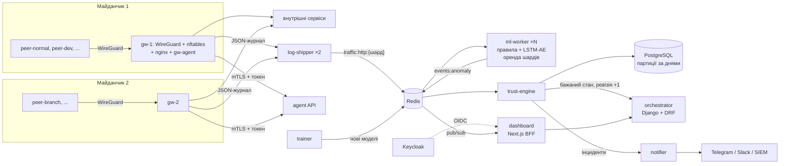

1. **Доступ.** Вузол підключається по WireGuard до свого шлюзу й бачить лише одну адресу:
   nginx на шлюзі. Маршрутів у внутрішню мережу в нього немає, nftables відкидає будь-який
   forward з `wg0`. Кожен запит проходить через L7-проксі, перевіряється політикою доступу
   й потрапляє в JSON-журнал.
2. **Телеметрія.** `log-shipper` кожного шлюзу читає журнал (з урахуванням ротації,
   at-least-once) і пише запити в шард-стрім Redis за вузлом.
3. **Виявлення.** `ml-worker` розкладає запити по 30-секундних вікнах, які зсуваються
   кожні 10 с. Правила спрацьовують одразу на кожному запиті, модель оцінює кожне закрите
   вікно разом з історією вузла.
4. **Довіра.** `trust-engine` рахує `довіра = 100 − Σ штрафᵢ · e^(−Δtᵢ/τ)`, відкриває
   інциденти й ухвалює рішення: обмежити ресурси, карантин, відкликання або зняття.
5. **Застосування.** Рішення змінює бажаний стан і піднімає ревізію шлюзу. `gw-agent` кожні
   2 секунди забирає стан по mTLS, звіряє з `wg show dump`, nft-сетом і політикою nginx та
   застосовує різницю. Від атаки до ізоляції минає 5–10 секунд.
6. **Спостереження.** Дашборд отримує події в реальному часі через SSE, сповіщення йдуть
   у зовнішні канали.

## Скриншоти

| | |
|---|---|
|  | **Вхід.** Через SSO (Keycloak) або локальним обліковим записом. Токени оркестратора зберігаються лише в httpOnly-cookie, спроби входу обмежено за частотою. Мову можна перемкнути одразу на сторінці входу. |
|  | **Огляд.** Активні вузли, вузли з обмеженим доступом, карантини, відкриті інциденти; стан оркестратора, обох шлюзів (ревізія «застосовано / бажано»), активна й тіньова моделі та стрічка подій у реальному часі. |
|  | **Вузли.** Усі вузли з шлюзом, IP у тунелі, статусом, рівнем довіри, останнім handshake і трафіком; фільтр за шлюзом. Кнопки залежать від ролі: аналітик ставить у карантин і знімає, відкликає лише адміністратор. |
|  | **Картка вузла після атаки.** Поточний доступ до кожного ресурсу з причиною рішення, графік довіри з порогами, запити за вікнами, аномальність за моделлю, інциденти, виявлення з поясненнями (ознаки моделі, лічильники правил) та останні запити, де запити, відхилені політикою, позначені окремо. |
|  | **Нормальний вузол із важким профілем.** Розробник регулярно вивантажує десятки мегабайт; правило обсягу порівнює вивантаження з особистою нормою вузла й не спрацьовує. Як член групи engineering він має доступ до `/admin`, адміністратор редагує групи прямо тут. |
|  | **Інциденти.** Інцидент відкривається, лише коли довіра впала нижче 70, тож поодинокі слабкі сигнали не створюють шуму. Видно критичність, мінімальну довіру та автоматичні дії. |
|  | **Інцидент.** Хронологія виявлень і автоматичних дій. Аналітик бере інцидент у роботу або закриває з нотаткою; все потрапляє в аудит. |
| 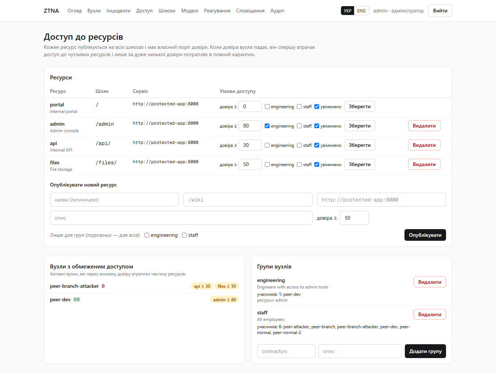 | **Доступ до ресурсів.** Опубліковані ресурси з префіксом шляху, сервісом, порогом довіри та групами; вузли, які зараз втратили частину ресурсів через знижену довіру; групи вузлів. Адміністратор публікує новий внутрішній сервіс без перезапуску шлюзів. |
| 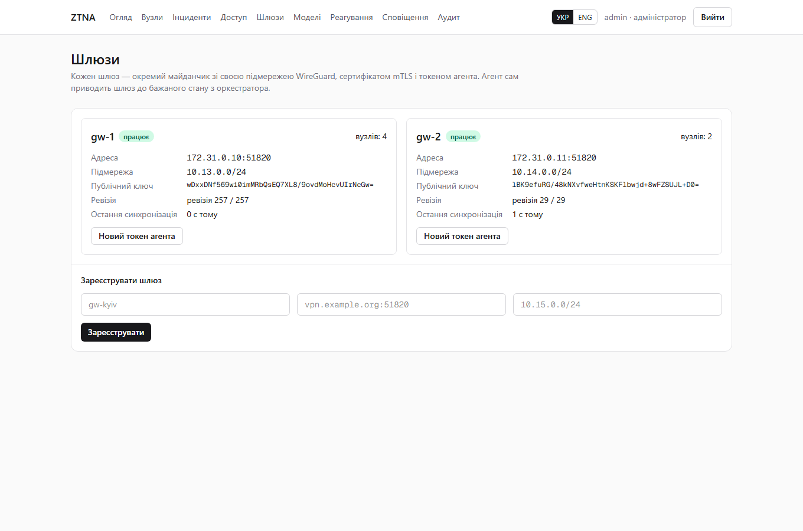 | **Шлюзи.** Кожен майданчик: адреса, підмережа WireGuard, публічний ключ, ревізія, кількість вузлів. Реєстрація нового шлюзу видає токен агента один раз; токен можна перевипустити. |
| 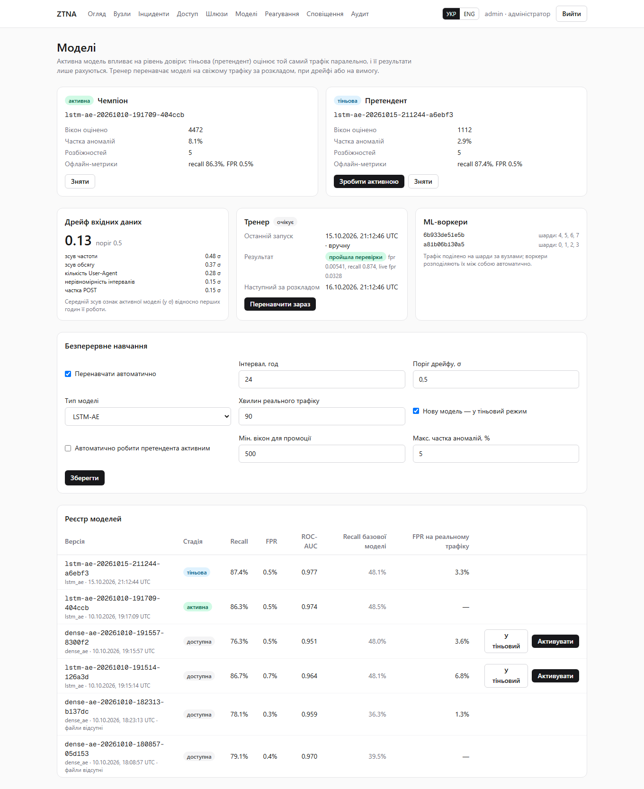 | **Моделі.** Чемпіон і претендент на живому трафіку (частка аномалій, розбіжності), дрейф вхідних даних, стан тренера з кнопкою «Перенавчити зараз», ML-воркери з їхніми шардами, налаштування безперервного навчання й реєстр моделей. |
| 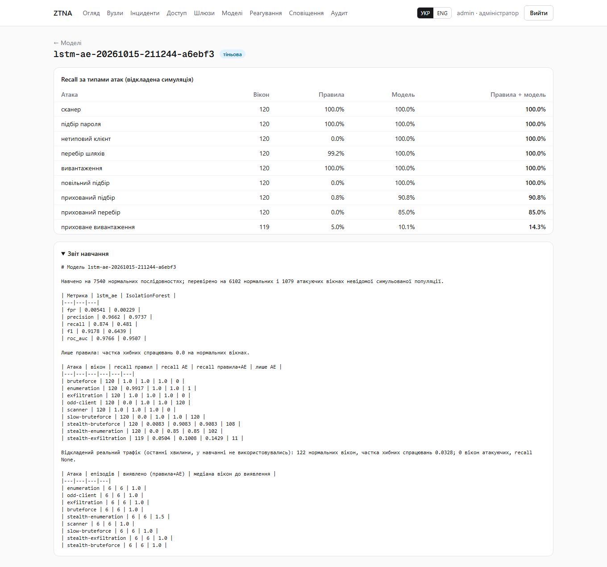 | **Звіт навчання.** Recall за кожним типом атаки окремо для правил, моделі та їх суми; повний звіт тренера українською. |
| 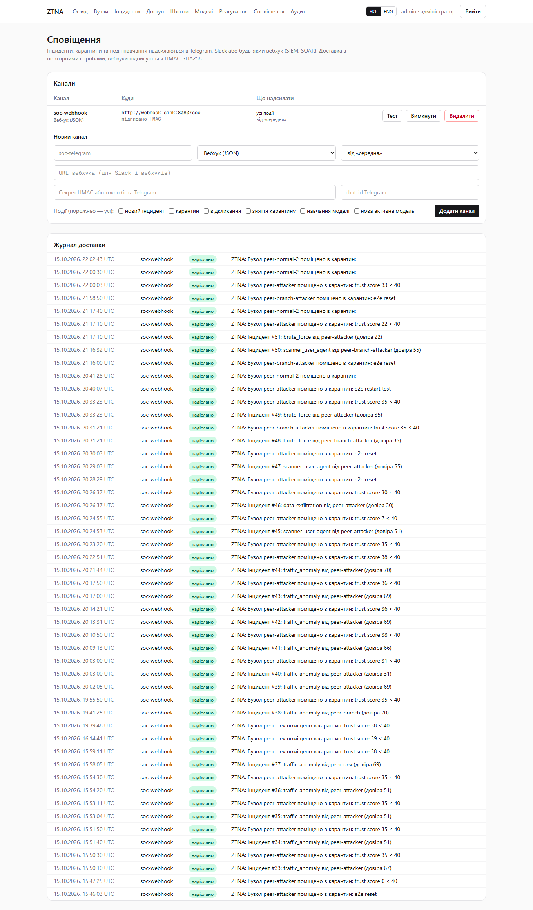 | **Сповіщення.** Канали (вебхук, Slack, Telegram) з фільтром подій і мінімальною критичністю, тестове повідомлення, журнал доставки з повторними спробами. |
| 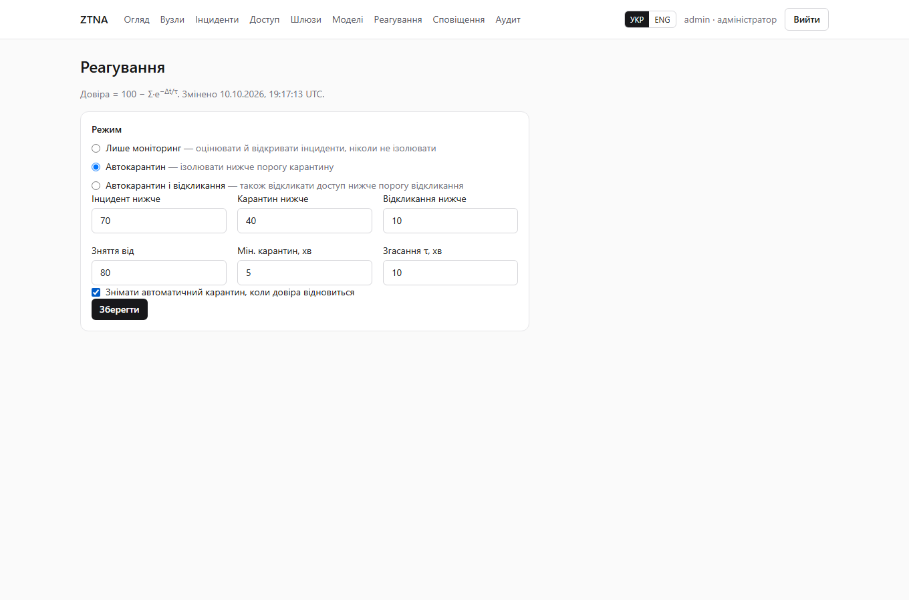 | **Реагування.** Режим (моніторинг, автокарантин, автовідкликання), пороги інциденту, карантину, відкликання та зняття (з гістерезисом), мінімальний час карантину, стала згасання τ. |
| 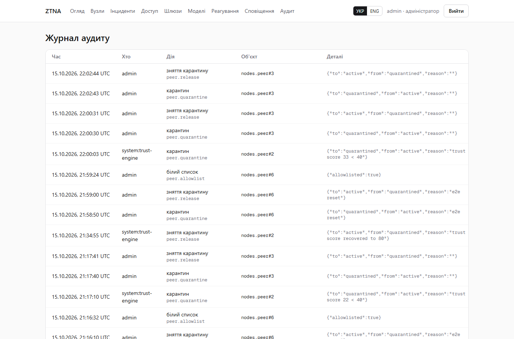 | **Аудит.** Усі зміни стану: хто (людина, `system:trust-engine`, `system:trainer`), що й з якими параметрами. |
| 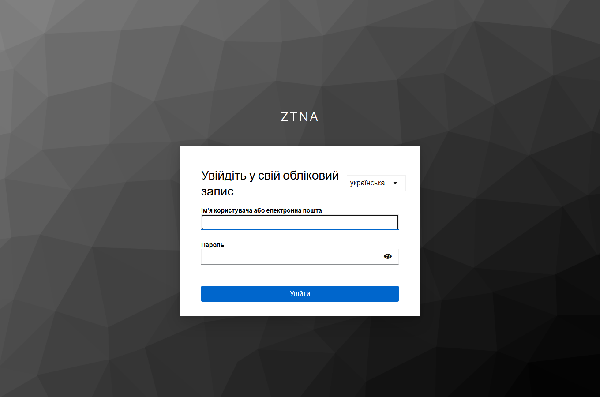 | **Єдиний вхід.** Сторінка Keycloak українською. Після входу роль у ZTNA визначається ролями realm (`ztna-admin`, `ztna-analyst`, `ztna-viewer`). |
| 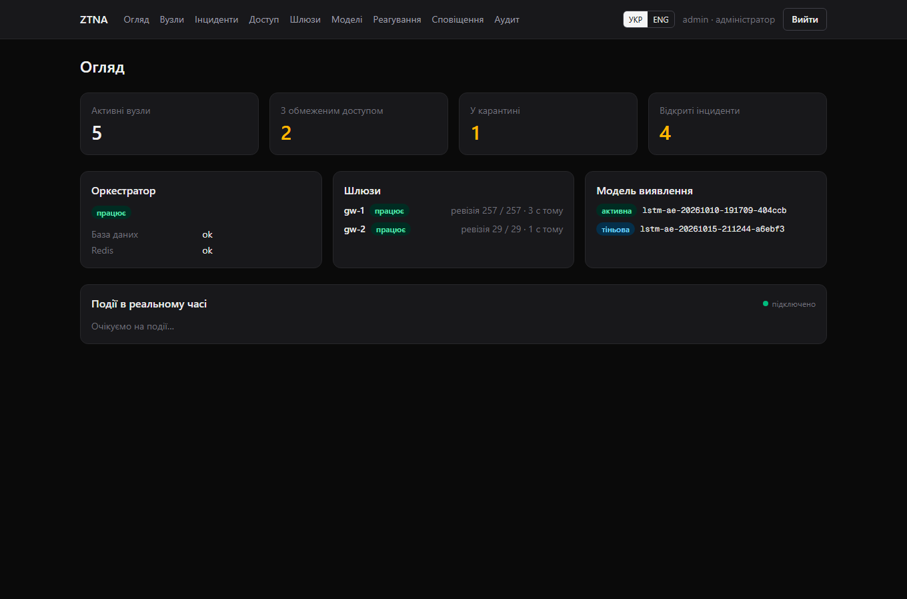 | **Темна тема** вмикається за системним налаштуванням. Кольори графіків перевірено на контраст для обох тем. |
| 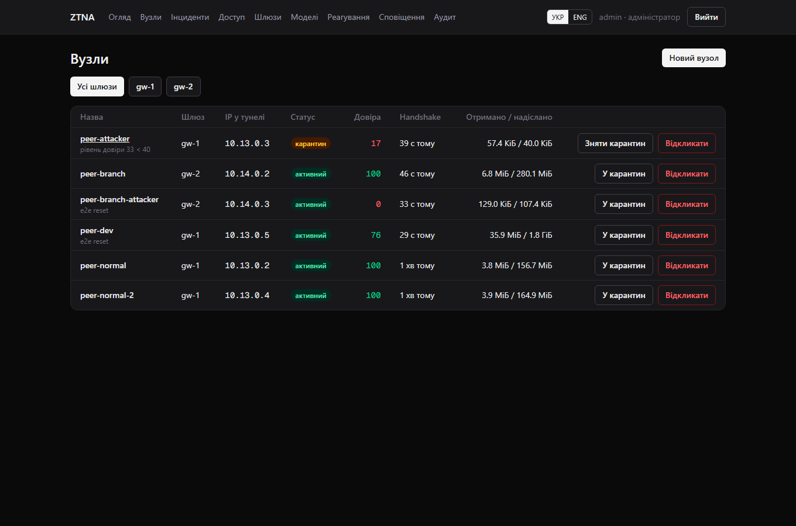 | Картка вузла в темній темі. Час усюди в UTC, однаково на сервері й у браузері. |

## Адаптивний доступ до ресурсів

Ресурс — це внутрішній сервіс, опублікований на шлюзах за префіксом шляху:

| Ресурс | Шлях | Умова доступу (демо) |
|---|---|---|
| `portal` | `/` | усі активні вузли |
| `api` | `/api/` | довіра ≥ 30 |
| `files` | `/files/` | довіра ≥ 50 |
| `admin` | `/admin` | група `engineering` і довіра ≥ 80 |

- Оркестратор обчислює для кожного шлюзу, які ресурси доступні кожному його вузлу, і
  передає це в бажаному стані. `gw-agent` рендерить три `map` для nginx (ресурс за шляхом,
  сервіс ресурсу, дозвіл для пари «IP вузла | ресурс»), перевіряє конфігурацію `nginx -t`
  і робить плавний reload. Якщо nginx конфігурацію не прийняв, відкочує її, а ревізію
  не підтверджує. Перевірка на кожен запит нічого не коштує: це hash-lookup у nginx.
- Ревізія шлюзу змінюється лише тоді, коли довіра вузла перетинає один із порогів ресурсів,
  а не на кожне оновлення оцінки.
- Відмова політики — це 403 від шлюзу з поясненням українською. У журналі вона позначена
  окремо й не впливає на ознаки моделі (це рішення шлюзу, а не поведінка сервісу), але
  наполегливі спроби достукатися до закритих ресурсів дають власне правило
  `access_denied_burst`.
- Шляхи й адреси сервісів обмежено безпечним алфавітом і перевіряються двічі: в
  оркестраторі й в агенті шлюзу, який не довіряє площині керування настільки, щоб
  вставляти в конфігурацію nginx довільний текст.
- Політика переживає перезапуск шлюзу (fail-static), на першому старті все заборонено,
  доки агент не синхронізується.

## Виявлення

Три шари, кожен закриває те, що погано ловлять інші.

### 1. Правила на вікні (миттєво, на кожному запиті)

| Правило | Умова за вікно 30 с | Штраф |
|---|---|---|
| `brute_force` | ≥ 8 відповідей 401/403 на шляхах автентифікації | 65 |
| `scanner_user_agent` | User-Agent сканера (sqlmap, nikto, gobuster, nuclei…) | 45 |
| `path_enumeration` | ≥ 15 відповідей 404, ≥ 70% унікальних шляхів | 45 |
| `data_exfiltration` | ≥ 64 МБ віддано за вікно | 65 |
| `request_flood` | ≥ 300 запитів | 30 |
| `missing_user_agent` | ≥ 5 запитів без User-Agent | 10 |
| `access_denied_burst` | ≥ 20 відмов політики доступу | 20 |

Пороги задаються змінними оточення `RULE_*` (див. `ml/ztna_ml/rules.py`).

### 2. Правило обсягу відносно норми вузла

`sustained_exfiltration` спрацьовує, якщо вузол віддав за 10 хвилин більше, ніж
`max(200 МБ, 8 × його звичайний обсяг за 10 хвилин)`. Звичайний обсяг — робастна повільна
EWMA: перші 5 хвилин рахується просте середнє, далі вікна вище 4× норми обрізаються й
враховуються з вагою вдесятеро меншою. Тож тривале вивантаження не може саме собі
підняти ліміт, а справжня зміна звичок усе одно засвоюється за години.

### 3. Модель

Вікно описується 16 ознаками (`ml/ztna_ml/features.py`): частота запитів, частки
4xx/404/401/5xx, унікальність шляхів, обсяг, розмір запиту, частка POST, кількість
User-Agent, частка нових для вузла User-Agent, рівномірність інтервалів і дві ознаки дрейфу
вузла (відношення швидкої EWMA до повільної для обсягу й частоти).

- **LSTM-AE** (у роботі) відтворює послідовність останніх 10 вікон вузла й ловить
  поведінку, незвичну в часі, а не в одному вікні.
- **Dense-AE** відтворює одне вікно; лишається як альтернатива.
- **IsolationForest** — базова модель для порівняння.

**Ковзні вікна.** Кожен вузол має три сітки вікон, зсунуті на 10 с. Кожна сітка — звичайна
послідовність 30-секундних вікон, тож модель бачить рівно те, на чому навчалася, але вікно
закривається кожні 10 с замість 30 с. Перший сигнал моделі приходить утричі швидше, а штраф
моделі ділиться на кількість фаз, щоб вплив на довіру за хвилину лишився тим самим і не
зросла ціна хибних спрацювань.

### Рівень довіри та рішення

- Довіра: `100 − Σ штраф·e^(−Δt/τ)`, τ = 10 хв.
- Нижче порогів ресурсів вузол втрачає відповідні ресурси; інцидент відкривається за
  довіри < 70, карантин — < 40, у режимі `auto_revoke` за < 10 доступ відкликається.
- Системний карантин знімається сам, коли довіра ≥ 80 і минуло щонайменше 5 хвилин
  (гістерезис і захист від брязкоту). Ручний карантин система не знімає.
- Ручне зняття карантину аналітиком «прощає» вузлу минулі аномалії. Спрацювання правила
  на трафіку до зняття не враховується; рішення LSTM, що спирається на хвилини історії,
  коштує лише ту частку штрафу, яка припадає на трафік після зняття.
- Білий список: вузол оцінюється й підлягає порогам ресурсів, але ніколи не ізолюється
  автоматично.

## Масштабування ML-воркерів

- `log-shipper` пише кожен запит у шард-стрім `traffic:http:{n}`, де `n = crc32(шлюз|IP) mod 8`.
  Усі запити вузла потрапляють в один шард, тож увесь його стан (вікна, норми, історія для
  моделі) живе в одному воркері.
- Воркери реєструються в `ml:workers` і беруть оренди `ml:lease:{n}` (`SET NX PX`, продовження
  Lua-скриптом). Цільова кількість шардів — `⌈8 / живих воркерів⌉`: новий воркер отримує
  свою частку, а коли воркер падає, його оренди спливають за 15 с і шарди переходять до
  живих.
- Кожні 5 с стан змінених вузлів шарду зберігається в `ml:state:{n}` **в одній транзакції**
  з підтвердженням (`XACK`) записів, які він покриває, і лише поки воркер тримає оренду
  (`WATCH`). Новий власник відновлює стан і переграє непідтверджений хвіст. Доставка
  at-least-once; trust-engine відкидає дублікати виявлень.
- Масштабування: `docker compose up -d --scale ml-worker=4`. У e2e один із двох воркерів
  вбивається посеред роботи: решта забирає всі шарди за ~20 с, норми вузлів не губляться,
  а наступна атака ізолюється вчасно.

## Безперервне навчання

- **Champion/challenger.** Одночасно працюють активна модель (її виявлення знижують довіру)
  і тіньова (оцінює ті самі вікна, результати лише рахуються). Для обох накопичуються
  частка аномалій і кількість розбіжностей на живому трафіку.
- **Дрейф.** Воркери накопичують погодинні суми нормалізованих ознак активної моделі.
  Перші 500 вікон після розгортання стають еталоном; дрейф — це середній зсув ознак (у σ)
  за останні дві години відносно еталона, з найбільш зміщеними ознаками.
- **Тренер** (`trainer`) перенавчає модель на синтетиці плюс реальному трафіку цієї мережі
  за розкладом, коли дрейф перевищує поріг, або за кнопкою в дашборді. Трафік вузла за ±15 хв навколо кожного його
  інциденту виключається з «нормального», решта лишається: так модель, що хибно спрацювала
  на нормальному вузлі, може вивчити його поведінку при перенавчанні.
- **Перевірки якості**: FPR на синтетиці ≤ 1%, recall ≥ 60%, FPR на відкладеному реальному
  трафіку ≤ 12%. Модель, що пройшла, оркестратор розгортає як претендента.
- **Автоматична промоція** (вимкнена за замовчуванням): претендент стає активним, коли
  оцінив достатньо вікон і його частка аномалій не вища за ліміт і за чемпіона.

## Кілька шлюзів

Шлюзи реєструються в дашборді (або з `GATEWAYS` під час першого запуску). Кожен має власну
підмережу (перетини заборонено), сертифікат mTLS, токен агента й `log-shipper`. Стенд
піднімає два шлюзи: `gw-1` (10.13.0.0/24) і `gw-2` (10.14.0.0/24, «філія»). Карантин
вузла на `gw-2` застосовується лише там.

## Єдиний вхід (SSO)

- Keycloak піднімається з імпортованим realm `ztna`: клієнт `ztna-dashboard`
  (confidential, PKCE S256), ролі realm `ztna-admin` / `ztna-analyst` / `ztna-viewer` у
  claim `roles`, українська локаль за замовчуванням і три демо-користувачі.
- BFF дашборду виконує authorization code flow з PKCE, `state` і `nonce`, обмінює код на
  ID-токен у внутрішній мережі й передає його оркестратору. Оркестратор **сам** перевіряє
  підпис за JWKS, issuer, audience, строк дії та nonce, створює або оновлює користувача
  (роль синхронізується при кожному вході) і видає власні JWT.
- SSO-користувач ніколи не перехоплює локальний обліковий запис з тим самим іменем.
  Користувач без ролі ZTNA увійти не може. Вихід завершує й сесію Keycloak.
- Локальний вхід лишається як аварійний (break-glass).

## Сповіщення

Події: новий інцидент, карантин, відкликання, зняття карантину, навчання моделі, промоція.
Сповіщення створюються в тій самій транзакції, що й зміна стану, а окремий сервіс
`notifier` доставляє їх з повторами (10 с, 30 с, 2 хв, 10 хв, 30 хв). Вебхуки підписуються
`X-ZTNA-Signature: sha256=<HMAC>`. Тексти — українською (`NOTIFY_LANGUAGE`). На стенді
демо-канал `soc-webhook` веде в `webhook-sink` (http://localhost:8090/messages).

## Зберігання даних

- `AnomalyEvent` і `TrustScoreSnapshot` — нативно партиційовані таблиці PostgreSQL з
  партицією на кожен день (міграція перетворює наявні таблиці разом з даними, зберігаючи
  ключі, індекси та зовнішні ключі). Партиції створюються на 14 днів наперед; страховочна
  DEFAULT-партиція приймає рядки поза діапазоном.
- Ретенція — видалення цілих партицій: виявлення 90 днів, оцінки довіри 30 днів
  (`EVENTS_RETENTION_DAYS`, `SCORES_RETENTION_DAYS`).
- Резервні копії PostgreSQL кожні 6 годин, зберігаються 7 днів.

## Якість і швидкість

Тест — окрема симульована популяція (інший seed): 16 нормальних користувачів (браузер і
розробник) і по 6 атакуючих на кожен із 9 сценаріїв.

| Метрика (вікна) | LSTM-AE | Dense-AE | IsolationForest |
|---|---|---|---|
| Recall | **0.863** | 0.763 | 0.485 |
| FPR | 0.51% | 0.52% | 0.25% |
| ROC-AUC | **0.974** | 0.951 | 0.947 |

Recall за сценаріями (правила + LSTM-AE, частка вікон атаки):

| Атака | Лише правила | LSTM-AE | Разом | Епізоди знайдено |
|---|---|---|---|---|
| підбір пароля, сканер, вивантаження | 100% | 100% | 100% | 6/6 |
| перебір шляхів | 99% | 100% | 100% | 6/6 |
| нетиповий клієнт (рідкісний UA, високий темп) | 0% | 100% | 100% | 6/6 |
| повільний підбір (під порогом правила) | 0% | 100% | 100% | 6/6 |
| прихований підбір (впереміш із браузингом) | 1% | 89% | 89% | 6/6 |
| прихований перебір | 0% | 81% | 81% | 6/6 |
| приховане вивантаження (~0.7 МБ/с у сесії) | 5% | 6% | 11% | 6/6, медіана 5 вікон |

Гучні атаки закривають правила: миттєво, зрозуміло й без хибних спрацювань. Модель
додає те, чого правила не бачать: прихований перебір, повільний підбір, незвичних
клієнтів. Приховане вивантаження ловить правило обсягу відносно норми вузла.

**Час до ізоляції на стенді** (e2e, від початку атаки до втрати доступу):

| Атака | Хто ловить | SLA | Час до ізоляції |
|---|---|---|---|
| підбір пароля (`gw-1`) | правило | 20 с | 5.1–6.7 с |
| підбір пароля (`gw-2`) | правило | 20 с | 5.8 с |
| сканер (User-Agent) | правило | 20 с | 5.6 с |
| вивантаження даних | правило обсягу | 20 с | 10.1 с |
| нетиповий клієнт | модель | 120 с | 6–43 с |
| прихований підбір | модель | 240 с | 116 с |
| приховане вивантаження | модель | 600 с | 119 с |

Нормальні вузли за весь прогін — без жодного інциденту. Після падіння одного ML-воркера
другий забирає всі шарди за ~23 с, без втрати стану вікон.

Пропускна здатність шляху виявлення — ~10 000 запитів/с на ядро на один воркер
(`python -m ztna_ml.bench`), масштабується кількістю воркерів.

## Безпека

- **Нульова довіра на мережевому рівні.** З тунелю доступний лише L7-проксі; forward у
  внутрішні мережі заборонено. Карантин — це сет nftables, оборотний і миттєвий; правило
  стоїть перед `ct established`, тож уже відкриті з'єднання теж рвуться. Доступ до кожного
  ресурсу додатково обмежено політикою.
- **Ключі WireGuard.** Приватний ключ шлюзу не залишає шлюз. Ключі вузлів генеруються на
  сервері, конфігурація видається один раз і ніде не зберігається.
- **Канал до шлюзу.** Агентський API — окремий процес з окремим URLconf; gunicorn вимагає
  клієнтський сертифікат, а шлюз додатково пред'являє токен (у базі — SHA-256). Агент
  перевіряє все, що потрапляє в конфігурацію nginx.
- **Fail-static.** Якщо оркестратор недоступний, шлюз тримає останній застосований стан
  (пірів, карантин і політику доступу) і сам виправляє ручний дрейф.
- **Користувачі.** RBAC (спостерігач / аналітик / адміністратор), аудит усіх змін, JWT з
  коротким access-токеном і ротацією refresh, обмеження частоти входу, SSO з перевіркою
  ID-токена на боці оркестратора.
- **Дашборд.** BFF: браузер ходить лише на свій origin, токени в httpOnly-cookie. CSP,
  `frame-ancestors 'none'`, nosniff, Referrer-Policy, Permissions-Policy. Вихід захищено
  Fetch Metadata від примусового виходу з чужого сайту.
- **ML.** Версія моделі перевіряється регулярним виразом (захист від path traversal), модель
  з іншим набором ознак не завантажиться, нова модель спершу йде в тіньовий режим.

## Запуск

Потрібен Docker Desktop з WSL2: у ядрі WSL2 вже є WireGuard.

```sh
cp deploy/.env.example deploy/.env   # змініть усі секрети
docker compose -f deploy/docker-compose.yml up -d --build
```

| Що | Де |
|---|---|
| Дашборд | http://localhost:3000 (локальний вхід — `DJANGO_ADMIN_*` з `.env`) |
| SSO-користувачі | `olena` (адміністратор), `taras` (аналітик), `iryna` (спостерігач), пароль `SSO_DEMO_PASSWORD` |
| Keycloak | http://localhost:8180 (консоль — `admin` / `KEYCLOAK_ADMIN_PASSWORD`) |
| API оркестратора | http://localhost:8000/api/, стан — `/healthz` |
| Отримані сповіщення | http://localhost:8090/messages |

Стенд піднімає два шлюзи й шість симульованих пристроїв: `peer-normal`, `peer-normal-2`
(браузинг), `peer-dev` (CLI й вивантаження, група engineering), `peer-attacker` (мовчить),
а на `gw-2` — `peer-branch` (браузинг) і `peer-branch-attacker` (мовчить).

### Атаки вручну

```sh
docker compose -f deploy/docker-compose.yml exec -d peer-attacker traffic bruteforce --duration 60
# сценарії: bruteforce, slow-bruteforce, stealth-bruteforce, scanner, enumeration,
# stealth-enumeration, exfiltration, stealth-exfiltration, odd-client
```

### Навчання моделі

У дашборді: **Моделі → Перенавчити зараз**. Тренер навчить LSTM-AE на синтетиці й останніх
90 хвилинах реального трафіку, перевірить якість і розгорне модель як претендента. Коли
претендент показав себе на живому трафіку — **Зробити активною** (або ввімкніть
автоматичну промоцію). Вручну:

```sh
docker compose -f deploy/docker-compose.yml --profile train run --rm ml-train \
  ztna_ml.train --out /models --model lstm --real-minutes 90 --exclude-ip 10.13.0.5
```

### Налаштування для продакшену

`DJANGO_SECURE_COOKIES=1` і `DJANGO_BEHIND_TLS_PROXY=1` за TLS-термінатором,
`DJANGO_CSRF_TRUSTED_ORIGINS`. Dev-PKI (`deploy/pki/gen-dev-pki.sh`) замінити сертифікатами
власного CA. Keycloak запускати в режимі `start` із зовнішньою базою та TLS, `PUBLIC_URL` і
`OIDC_*` вказати на реальні адреси. Секрети передавати через docker secrets або vault.

## Перевірка

| Набір | Команда | Що перевіряє |
|---|---|---|
| Оркестратор | `cd orchestrator && pytest` | вузли, шлюзи й їхня реєстрація, RBAC, agent API, політика доступу, trust engine, champion/challenger і промоція, сповіщення з повторами й HMAC, SSO (підпис, nonce, audience, ролі), переклади API — 76 тестів; з `DATABASE_URL` на PostgreSQL ще й партиціювання |
| ML | `cd ml && pytest` | вікна й фази, ознаки, правила, правило обсягу, відновлення стану з чекпоінта, оренди й переїзд шарду, тіньова модель, дрейф, тренер і перевірки якості, ONNX — 39 тестів |
| gw-agent | `cd gateway/agent && pytest` | парсинг `wg`/`nft`, план змін, рендер політики nginx (порядок, екранування, відсів небезпечних значень), відкат — 9 тестів |
| log-shipper | `cd services/log-shipper && pytest` | неповні рядки, чекпоінт, усічення файлу, маршрутизація в шарди — 6 тестів |
| E2E | `python deploy/e2e.py` | тунель на обох шлюзах, групова політика, ізоляція за кожною атакою, сповіщення, ступінчастий доступ, атака на `gw-2`, падіння ML-воркера, відсутність інцидентів у нормальних вузлів, відновлення після перезапуску шлюзу; `--train-timeout 1800` — ще й перенавчання через тренер |
| UI | `cd dashboard && npx playwright test` | вхід, помилки, карантин з UI з live-подією в іншій вкладці, усі розділи, перемикання мови, SSO через Keycloak з виходом |
| Скриншоти | `SCREENSHOTS=1 npx playwright test e2e/screenshots.spec.ts` | оновлює `docs/screenshots/` |

Для UI-тестів потрібні `E2E_USER`, `E2E_PASSWORD` і `E2E_SSO_PASSWORD`. CI
(`.github/workflows/ci.yml`) запускає лінтери й тести всіх компонентів (оркестратор — на
SQLite і PostgreSQL), перевіряє повноту міграцій і збирає всі образи.

## Структура репозиторію

```
gateway/              WireGuard + nftables + nginx; agent/ — gw-agent (stdlib Python)
orchestrator/         Django: accounts (ролі, SSO), nodes (вузли, шлюзи, agent API),
                      access (ресурси, групи, політика), trust (довіра, інциденти,
                      реагування), mlops (реєстр, champion/challenger), notify, audit,
                      core (live-події, партиції); locale/ — українські повідомлення
ml/                   ztna_ml: події, вікна й ознаки, правила, правило обсягу, шарди,
                      воркер, тренер, моделі (dense_ae, lstm_ae, iforest), датаген,
                      навчання, оцінка, livecheck, бенчмарк
dashboard/            Next.js (App Router): BFF, OIDC, SSE, i18n (uk/en), сторінки, Playwright
services/             protected-app (демо-сервіс), log-shipper, webhook-sink (демо-приймач)
simulator/peer/       пристрій-вузол і профілі поведінки (спільні для стенду й датагену)
deploy/               docker-compose, Keycloak realm, dev-PKI, бекапи, e2e.py
docs/screenshots/     скриншоти для цього README
```

## Обмеження

- **Синтетика ≠ реальність.** Профілі поведінки спрощені, тож на реальному трафіку частка
  хибних спрацювань моделі помітно вища, ніж на синтетиці. Це пом'якшують м'які штрафи
  моделі, рішення за накопиченою довірою й тепер безперервне перенавчання на трафіку
  самої мережі, але на справжньому впровадженні моделі потрібні тижні реальних даних.
- **Лише HTTP.** Політика доступу працює на рівні L7 за префіксами шляхів; довільні TCP/UDP
  сервіси через шлюз не публікуються.
- **Без відмовостійкості сховищ.** Redis і PostgreSQL — по одному екземпляру (для
  продакшену — Redis Sentinel/Cluster і репліка PostgreSQL).
- **Keycloak у dev-режимі.** На стенді він працює з вбудованою базою та без TLS.
